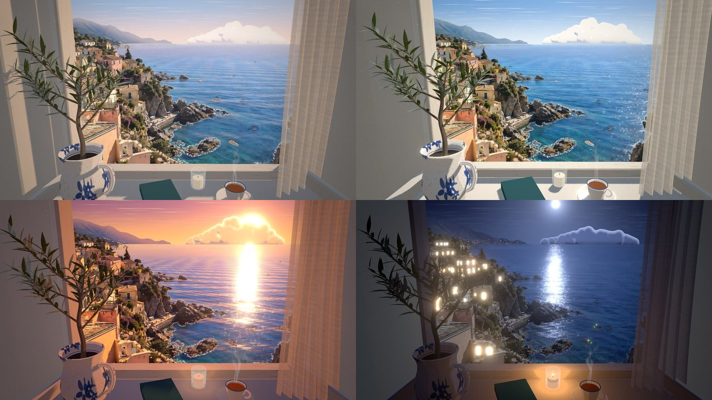

# 窓辺の海 — finestra sul mare

地中海の海辺の町を、窓辺に座って眺める。そんな時間をブラウザの中に置いておくための、ゆっくり動く 3D の風景です。

GPT-image-2.5 で生成した一枚の画像（`source/coast.webp`）をベースに、アニメ背景画ふうに描き直し、奥行きのある層に分けて、窓辺の部屋ごと Three.js で組み立てています。

**▶ ブラウザで開く: https://tanuu5.github.io/madobe-no-umi/**



- 元画像: GPT-image-2.5 で生成（`source/coast.webp`）
- 作成: Claude Opus 5.5（MAX）

## できること

- **窓辺でくつろぐ** — マウスを動かすと頭の位置が少しずれ、窓枠と外の景色の間に本物の視差が生まれます。ホイールで窓に寄ったり、椅子にもたれたり。
- **時間が移ろう** — 朝・昼・夕・夜を切り替えられます。「移ろう」を押すと一日がゆっくり巡ります（1 周およそ 5 分）。
- **生きている景色** — 波のきらめき、岩に寄せる白波、行き交う小舟と航跡、ゆっくり流れる入道雲、カモメ、そよぐオリーブとカーテン、紅茶の湯気、陽だまりの埃。
- **夜の窓明かり** — 日が暮れると町の窓にひとつずつ灯りがともり、月の光が海に道をつくります。窓辺ではキャンドルが揺れます。
- **環境音** — 「波の音」で、打ち寄せる波・窓から入る風・ときどき鳴るグラスのチャイム・夜の虫の声が流れます（すべてその場で合成）。

| 操作 | |
| --- | --- |
| マウス移動 | 視点が少し動く（身をずらす） |
| ホイール | 窓に寄る／離れる |
| `1`〜`4` | 朝／昼／夕／夜 |
| `C` | 移ろう（時間を進める） |
| `S` | 波の音 |
| `F` | 全画面 |
| `H` | 操作パネルを隠す |
| スマートフォン | 横になぞると景色を見渡せます |

しばらく操作しないと、操作パネルとカーソルは自動で隠れます。

## 動かし方

ES モジュールと画像を読み込むので、ファイルを直接開くのではなく、ローカルサーバー経由で開いてください。

```bash
python3 -m http.server 8000
```

ブラウザで `http://localhost:8000` を開きます。GitHub Pages などの静的ホスティングにそのまま置いても動きます（このリポジトリも GitHub Pages で公開しています）。Three.js は jsDelivr の CDN から読み込みます（ビルド不要）。

WebGL2 が使えるブラウザが必要です。画面の描画負荷に合わせて解像度を自動で調整します。

## しくみ

| 層 | やっていること |
| --- | --- |
| 空 | 手続き的に描いた空。グラデーション、球を重ねた入道雲（アニメ風のセル陰影と縁の光）、薄い筋雲、太陽・月・星 |
| 遠景〜町 | 元画像から切り出した陸地を、手で置いた奥行きアンカーから作った深度グリッドに貼り直したもの。視点を動かすと近い屋根ほど大きくずれる |
| 海 | 本物の平面。元画像の海を、画像を撮ったと仮定したカメラから投影し、その上に波の法線・太陽や月のきらめき・筆のような波頭・岩の白波・舟の航跡・浅瀬の光の網を重ねる |
| 小舟・カモメ | トゥーン陰影の 3D モデル。航路は元画像上のピクセル座標で決め、海面に落として動かす |
| 部屋 | 窓枠・斜めに開いた壁の奥行き・大理石の窓台・マジョリカ焼きの水差しとオリーブ・カップ・本・キャンドル・カーテンを 3D で組み、影を落とす |
| 仕上げ | ブルーム（強い光だけ）、色調、周辺減光、うっすらした粒子 |

部屋の中と外は別々のカメラで描いています。外側のカメラだけ頭の動きを少し大きめに反映させて、遠くの町にも奥行きが感じられるようにしています（二つの場面は形を共有しないので、ずれは見えません）。

## アセットの作り直し

`assets/` の画像は `tools/build_assets.py` が `source/coast.webp` から作ります。元画像を差し替えたり、塗りの具合を変えたいときに使います。

```bash
pip install numpy scipy pillow torch
python3 tools/build_assets.py
```

処理の流れ:

1. 空・海・陸・窓枠の領域に分ける（色と連結成分、窓枠は画像上の線で指定）
2. 窓枠に隠れていた部分を、枠の縁で景色を折り返して埋める（視差で少しだけ見える範囲）
3. 海からボートと太陽のきらめきを取り除き、陸の下は海の色でなめらかに埋める
4. 2 倍に拡大してから異方性 Kuwahara フィルタを 2 回かけ、Oklab 色空間でアニメ背景らしい色に寄せる
5. 奥行きアンカーを薄板スプラインで補間して深度グリッドにする
6. 夜の窓明かり（手で置いた窓と街灯、対岸の町の灯り）の地図を作る

`--debug DIR` を付けると、途中のマスクや塗りの結果を画像で書き出します。

## ファイル構成

```
index.html            画面とスタイル、操作パネル
src/main.js           読み込み・シーン組み立て・ループ
src/sky.js            空と雲
src/sea.js            海面
src/land.js           陸（深度グリッド）と夜の窓明かり
src/interior.js       部屋と窓
src/plant.js          オリーブと水差し
src/curtain.js        カーテン
src/effects.js        湯気・炎・陽だまりの埃
src/boats.js          小舟
src/gulls.js          カモメ
src/timeofday.js      朝・昼・夕・夜の色と光
src/rig.js            視点（頭の動き・ホイール・スワイプ）
src/post.js           ブルームと色調
src/audio.js          環境音の合成
src/ui.js             操作パネル
src/textures.js       部屋の小物の手続きテクスチャ
src/glsl.js           共有シェーダ関数
tools/build_assets.py アセット生成
assets/               生成済みアセット
source/coast.webp     元画像（GPT-image-2.5 で生成）
docs/                 README 用の画像
```

## クレジット

- 元画像: GPT-image-2.5 で生成した画像をベースにしています（`source/coast.webp`）
- 作成: Claude Opus 5.5（MAX）— 画像の分解と塗り、3D の組み立て、シェーダー、音、README まで

## 使用しているもの

- [three.js](https://threejs.org/)（MIT License）
- フォント: [Zen Old Mincho](https://fonts.google.com/specimen/Zen+Old+Mincho)、[Zen Maru Gothic](https://fonts.google.com/specimen/Zen+Maru+Gothic)、[Bodoni Moda](https://fonts.google.com/specimen/Bodoni+Moda)（いずれも SIL Open Font License、Google Fonts から読み込み）

## ライセンス

[MIT License](LICENSE)
